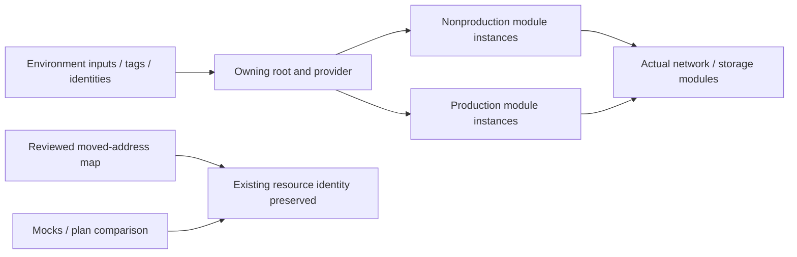

# Reusable Terraform Modules and Safe Infrastructure Adoption

**Reuse cloud setup patterns without accidentally replacing the resources already in use.**

[Business problem](#the-business-problem) · [Solution](#the-solution) · [Strengths](#engineering-strengths) · [Proof](#proof-it-works) · [Commands](docs/COMMANDS.md)


## The Business Problem

Production and testing used many of the same network and storage patterns. Moving those definitions into shared code could make maintenance easier, but it had to preserve existing resources, permissions and ownership. Unrelated configuration differences also needed to stay separate from that work.

## The Solution

Put the repeated patterns into Terraform modules, which are reusable groups of resource definitions. Give each environment its own names and settings. Map old resource addresses to the new module addresses and review the proposed changes before any real state update.

**Business outcome:** The actual adoption work preserved resource identities and kept unrelated background-job differences separate. This public example demonstrates reuse without reading or changing live state.

## Engineering Strengths

| Strength | Practical value |
| --- | --- |
| **Consistent controls** | The same module supplies network delegation, storage privacy and diagnostic patterns across selected environments. |
| **Explicit contracts** | Inputs identify names, ranges, groups and destinations; outputs connect consumers without copying resource internals. |
| **Safer refactoring** | Reviewed address mapping and moved declarations help preserve resource identity when code layout changes. |

## Architecture



This project is derived from actual workforce-platform implementation. Identifying labels/targets use examples. The local viewer and demonstration are new reference code; [source mapping](docs/SOURCE-MAP.md) identifies the copied/extracted files and limitations.

## What Was Built

| Component | Purpose | Implementation |
| --- | --- | --- |
| Actual network module | VNet, integration delegation, endpoint subnet and outputs | [Module](infra/modules/network/) |
| Actual storage module | Keyless/private configuration, containers, diagnostics and role inputs | [Module](infra/modules/storage/) |
| Two-environment public root | Reuse with different names/ranges under a default-Off wrapper | [Root](infra/main.tf) |
| Actual adoption references | Original address mapping and retained moved declarations | [Reference](reference/adoption/) |
| Local demonstration | Exercise actual rule/evaluation code using fictional data | [Demo](scripts/demo.py) |
| Dated context | Keep recorded implementation separate from new local evidence | [Context](data/history.json) |

## Proof It Works

### 1. Run focused checks

```bash
python -B -m unittest discover -s scripts -p 'test_*.py' -v
terraform -chdir=infra init -backend=false -input=false
terraform -chdir=infra validate
terraform -chdir=infra test
```

**Observed:** Four Python reference checks and two Terraform cases using simulated responses passed. The mock composition keeps production/nonproduction instances distinct. [Validation](docs/VALIDATION.md) records the exact scope and distinguishes pure/mock checks from testing with the hosted services.

### 2. Inspect the decision output


The output is explicitly fictional and exercises the included logic. A successful rule test or simulation is not a completed real-world operation. The public two-environment composition is a reference. Real environments retain their own roots/state and commissioned inputs; no live state or cloud resource was accessed.

### 3. Open the reference viewer

```bash
python -B scripts/preview.py --port 8139
```

Open [the local reference](http://127.0.0.1:8139). Switch between Overview, Working example and Implementation context. Ctrl+C stops it. Screenshots are genuine local captures, not hosted application/Azure Portal screenshots.

## Modules, State and Existing Resources

A module is a reusable configuration boundary, not a separate state automatically. The owning root/backend determines state ownership. A resource moves in Terraform's address space when code moves under a module; its Azure identity can remain unchanged if the reviewed mapping preserves it.

The actual adoption references include moved declarations and an old-to-new address map. They are kept outside the executable public root: this repository has no matching live state, imports or commissioned values. Do not copy them into an unrelated environment and expect adoption to occur safely.

The recorded portal candidate showed two moved resources with no-op actions and unchanged Azure IDs. Preexisting worker drift was kept separate. A later reviewed state operation also recorded module addresses; that historical lesson is why state writes, source changes and resource mutations must be described separately. None was repeated here.

The same module definition does not mean production and nonproduction should share secrets, administrators or storage accounts. The reference passes explicit names/ranges/groups and reuses a fictional observation workspace only for mock composition. Real roots/providers/state remain separately owned.

[HashiCorp modules overview](https://developer.hashicorp.com/terraform/language/modules) explains reuse; [module refactoring](https://developer.hashicorp.com/terraform/language/modules/develop/refactoring) covers address moves.


## Operations, Limits and Growth

State clearly which system is being checked, who owns it and what the result actually proves. Test the cases that should be denied or rejected as well as the successful ones. Keep incomplete results clearly marked. Preserve private inputs and unrelated changes. Before expanding the design, measure what is slow or limited, review costs, and check access restrictions and recovery again. [Operations and scaling](docs/OPERATIONS-AND-SCALING.md).

## Project Guides

| Guide | Purpose |
| --- | --- |
| [Implementation](docs/IMPLEMENTATION.md) | Rules, boundaries and actual source design |
| [Commands](docs/COMMANDS.md) | Local tests, expected output and inspection |
| [Operations and scaling](docs/OPERATIONS-AND-SCALING.md) | Strengths, weaknesses, costs and growth |
| [Source map](docs/SOURCE-MAP.md) | Actual files and public adaptations |
| [Validation](docs/VALIDATION.md) | Observed local evidence and remaining integration scope |

No Azure service, business record or live state was changed. The public validation workflow is manual-only and was not dispatched, conserving hosted Actions minutes.
