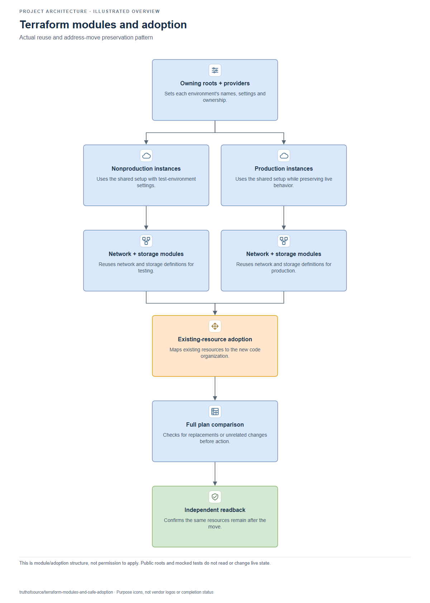

# Reusable Terraform Modules and Safe Infrastructure Adoption

[](docs/diagrams/architecture.svg)

[View SVG](docs/diagrams/architecture.svg) · [Download PNG](docs/diagrams/architecture.png) · [Edit in draw.io](docs/diagrams/architecture.drawio)

**Reuse cloud setup patterns without accidentally replacing the resources already in use.**

[Business problem](#the-business-problem) · [Solution](#the-solution) · [Strengths](#engineering-strengths) · [Proof](#proof-it-works) · [Commands](docs/COMMANDS.md) · [Step by step](#step-by-step)

## The Business Problem

Production and testing repeat many of the same network, storage and application-hosting patterns. Maintaining separate copies means an improvement can reach one environment while another keeps an older setting. As the platform grows, engineers spend more time comparing similar definitions and deciding which differences are intentional.

Consolidating those definitions introduces a different risk: the existing resources already hold records, permissions and service connections. A code cleanup that Terraform interprets as replacement could interrupt a live service or put retained data at risk. Unrelated configuration drift can make that review harder.

The business need was to reduce repeated maintenance while preserving the identity and ownership of existing resources, with a proposed-change review that separates harmless code reorganization from real infrastructure changes.

## The Solution

Put the repeated patterns into Terraform modules, which are reusable groups of resource definitions. Give each environment its own names and settings. Map old resource addresses to the new module addresses and review the proposed changes before any real state update.

**Business outcome:** The actual adoption work preserved resource identities and kept unrelated background-job differences separate. This public example demonstrates reuse without reading or changing live state.

## Tools Used and What They Do

| Tool or service | What it does | Where it fits |
| --- | --- | --- |
| Terraform modules, moved blocks and state | Reuse configuration while retaining ownership of existing resource IDs. | Actual adoption pattern; a state move is not a resource copy or Azure rename. |
| AzureRM and AzureAD providers | Translate reviewed resource/identity declarations into the appropriate service operations. | Provider source/lock choices remain part of the reviewed environment. |
| terraform fmt, validate, test and plan | Check formatting, configuration, mock expectations and proposed changes. | Different checks; a mock test or clean plan does not establish functional connectivity. |
| Azure CLI | Read the actual target resource when plan/state evidence needs comparison. | Operating utility; not permission to apply an unrelated change. |
| Python | Run the local module-adoption illustration. | Public reference model, not the authoritative Azure/Terraform state. |
| GitHub Actions | Coordinate reference validation. | Manual-only public workflow; no cloud adoption is applied. |

Keep actual source-to-module moves separate from the public teaching root. Preserve state backups, exact IDs and independent post-change checks before claiming a successful adoption.

## Step by Step

Your own reusable Azure network module and a root configuration that calls it.

[Open the standalone build guide](docs/BUILD-YOUR-OWN.md) or follow the same complete instructions below.

Start with a new folder, your own files and your own accounts. The numbered steps below describe the build; no portfolio repository checkout is required. The existing implementation/evidence elsewhere in this repository is a separate reference, not a claim that your new build has already passed.

### Prerequisites

Terraform, Azure CLI and a dedicated lab subscription scope. Existing production state is not an input to this new-build tutorial.

Use Bash on Linux/macOS/WSL for Bash blocks and PowerShell for PowerShell blocks. Select the tool versions supported by the official sources below, record the versions you actually install and retain generated dependency locks. Cloud resources, scanner downloads, logs and external AI calls can create costs; review the stated scope before enabling them.

### Create your project folder

Choose a new folder name. These first commands create a blank project; an optional `git init` gives it its own history. Create parent directories in your editor when a later step introduces a nested file.

```bash
mkdir my-terraform-modules-and-safe-adoption
cd my-terraform-modules-and-safe-adoption
git init
```

Create `.gitignore` before saving credentials or build outputs:

```gitignore
.venv/
node_modules/
.env
.env.*
local.settings.json
credentials.json
token.json
*.pem
*.key
*.tfstate*
*.tfplan
.terraform/
private*/
captures/
backups/
batch.json
reports/
out/
app-config.local.yaml
```

The source/file snippets are a starting implementation you type or paste into the named files. Replace `YOUR_*`, names, regions and addresses only with values from your own lab; do not place real client/employee records in a test project. Keep your terminal in this project root unless a step explicitly changes directory.

Before a first commit, set your own repository-local author with `git config user.name "YOUR_NAME"` and `git config user.email "YOUR_PUBLIC_COMMIT_EMAIL"`. Review `git status --short` and the staged diff before publishing; ignored local files are not a substitute for reviewing what you upload.

### Step 1 — Create the module layout

**Where:** Your blank project folder.

Create modules/network and envs/lab directories. Keep reusable resource definitions in the module and environment selection/provider configuration in the root.

```bash
mkdir -p modules/network envs/lab
```

**Check before continuing:** Your folder structure separates what gets built from where it gets built.

### Step 2 — Write the reusable network module

**Where:** modules/network/main.tf.

Create the variables and resources below. Require the caller to supply name, region and address space rather than baking another organization's subscription into the module.

Create **`modules/network/main.tf`** with the following contents:

```hcl
variable "name" {
  type = string
}
variable "location" {
  type = string
}
variable "address_space" {
  type = list(string)
}
resource "azurerm_resource_group" "this" {
  name = var.name
  location = var.location
}
resource "azurerm_virtual_network" "this" {
  name = "${var.name}-vnet"
  location = azurerm_resource_group.this.location
  resource_group_name = azurerm_resource_group.this.name
  address_space = var.address_space
}
output "vnet_id" {
  value = azurerm_virtual_network.this.id
}
```

**Check before continuing:** The module defines one group and VNet from its inputs.

### Step 3 — Write your environment root

**Where:** envs/lab/main.tf.

Create the provider/root call below and substitute your own names and non-overlapping address range. Save the generated provider lockfile and keep state/plan files private.

Create **`envs/lab/main.tf`** with the following contents:

```hcl
terraform {
  required_providers {
    azurerm = {
      source = "hashicorp/azurerm"
      version = "~> 4.0"
    }
  }
}
variable "subscription_id" {
  type = string
}
provider "azurerm" {
  features {}
  subscription_id = var.subscription_id
}
module "network" {
  source = "../../modules/network"
  name = "rg-my-module-lab"
  location = "eastus2"
  address_space = ["10.70.0.0/16"]
}
```

**Check before continuing:** The root calls your module through a local relative path.

### Step 4 — Validate and review your own plan

**Where:** Your project root.

Initialize the environment root, format/validate, select your own subscription and save a plan. Read the planned resources before deciding whether to create the lab.

```bash
az login
export TF_VAR_subscription_id="YOUR_SUBSCRIPTION_ID"
terraform -chdir=envs/lab init
terraform fmt -recursive
terraform -chdir=envs/lab validate
terraform -chdir=envs/lab plan -out=lab.tfplan
terraform -chdir=envs/lab show lab.tfplan
```

**Check before continuing:** You have a valid module call and a reviewed resource list.

### Step 5 — Build and verify the dedicated lab

**Where:** Your terminal and Azure Portal.

Apply only your reviewed saved plan, then inspect the resulting group/VNet and run another plan. The second plan should explain any drift; do not automatically apply a replacement because you changed a module address.

```bash
terraform -chdir=envs/lab apply lab.tfplan
terraform -chdir=envs/lab plan
```

**Check before continuing:** Your new resources exist and the follow-up plan has the expected outcome.

### Step 6 — Explain safe adoption and cleanup

**Where:** Your own state and documentation.

For an existing environment, compare resource IDs and review import/moved mappings separately; this new-build exercise does not migrate production state. For this lab, review a destroy plan in the same root and remove only its isolated resources.

**Check before continuing:** You distinguish module reuse, existing-state adoption and resource deletion.

### Verification and your own screenshots

| Evidence | What to record | Your result |
| --- | --- | --- |
| New build | Your own files/resource settings and tool versions | Not yet recorded |
| Working path | The actual successful request, configuration or recovery result | Not yet recorded |
| Failure boundary | A meaningful denied, malformed, stale or failed case | Not yet recorded |
| Recovery / cleanup | What you restored or removed and what remains billed | Not yet recorded |

Capture your own architecture/configuration, one working result and one failure/recovery result. Keep tokens, credentials, personal records and private identifiers out of public screenshots. The architecture diagram explains the design; record your own results rather than treating it as execution evidence.

### Troubleshooting order

1. Confirm the named file, working directory and selected tool/interpreter.
2. Check the exact input and resource/account selected for the failing step.
3. Separate identity permission, network/DNS reachability and application validation.
4. Keep the actual error and reconcile an unknown write outcome before repeating it; do not widen access or repeat paid operations blindly.

The numbered steps describe a build procedure. Local syntax checks, an accepted API request, a completed hosted operation and a human verification are different evidence levels; fill in the verification table with what you actually observed.

### Official implementation references

- [developer.hashicorp.com — develop](https://developer.hashicorp.com/terraform/language/modules/develop)
- [developer.hashicorp.com — refactoring](https://developer.hashicorp.com/terraform/language/modules/develop/refactoring)

The walkthrough layout follows the prerequisites → creation/configuration → test → verification → troubleshooting → cleanup pattern of the [Splunk project reference](https://github.com/davidharris6/splunk-siem-log-analysis). Its Splunk-specific settings are not copied into unrelated projects.

<details>
<summary>Reference: how the existing platform implementation operates</summary>

A short walkthrough of the process, with technical instructions and evidence limits in the sections below.

1. **Find the repeated setup pattern** — Identify infrastructure that uses the same structure across environments. Put that structure into a reusable Terraform module with explicit inputs.

2. **Keep environment choices separate** — Supply the names, address ranges and access settings for each environment. Sharing a module does not mean sharing every resource or permission.

3. **Map existing resources carefully (Terraform moved blocks)** — Record how old resource addresses correspond to the new module addresses. Review the proposed plan for unintended replacements or unrelated changes.

4. **Validate before a live migration (Terraform checks)** — Run the local examples and simulated infrastructure checks. This public project does not read or change the live infrastructure state.

</details>

## Engineering Strengths

| Strength | Practical value |
| --- | --- |
| **Consistent controls** | Reuse the same network, private-storage and logging patterns across the selected environments. |
| **Explicit contracts** | Pass in the names, address ranges, groups and destinations each environment needs. Return useful results so other code can use them. |
| **Safer refactoring** | Record where each resource moves in the code so the existing cloud resource can be kept. |

## Architecture

[View the illustrated project overview](docs/diagrams/architecture.svg).

This project is derived from actual workforce-platform implementation. Identifying labels/targets use examples. The local viewer and demonstration are new reference code; [source mapping](docs/SOURCE-MAP.md) identifies the copied/extracted files and limitations.

## What Was Built

| Component | Purpose | Implementation |
| --- | --- | --- |
| Actual network module | VNet, integration delegation, endpoint subnet and outputs | [Module](infra/modules/network/) |
| Actual storage module | Keyless/private configuration, containers, diagnostics and role inputs | [Module](infra/modules/storage/) |
| Two-environment public root | Reuse with different names/ranges under a default-Off wrapper | [Root](infra/main.tf) |
| Actual adoption references | Original address mapping and retained moved declarations | [Reference](reference/adoption/) |
| Local demonstration | Exercise actual rule/evaluation code using fictional data | [Demo](scripts/demo.py) |
| Dated context | Keep earlier platform results separate from the new local example | [Context](data/history.json) |

## Proof It Works

### 1. Run focused checks

```bash
python -B -m unittest discover -s scripts -p 'test_*.py' -v
terraform -chdir=infra init -backend=false -input=false
terraform -chdir=infra validate
terraform -chdir=infra test
```

**Observed:** Four Python reference checks and two Terraform cases using simulated responses passed. The mock composition keeps production/nonproduction instances distinct. [Validation](docs/VALIDATION.md) records the exact scope and distinguishes pure/mock checks from testing with the hosted services.

### 2. Inspect the decision output

The output is explicitly fictional and exercises the included logic. A successful rule test or simulation is not a completed real-world operation. The public two-environment composition is a reference. Real environments retain their own roots/state and commissioned inputs; no live state or cloud resource was accessed.

### 3. Open the reference viewer

```bash
python -B scripts/preview.py --port 8139
```

Open [the local reference](http://127.0.0.1:8139). Switch between Overview, Working example and Implementation context. Ctrl+C stops it. Proper application and Azure screenshots are deferred; this remains a runnable local reference.

## Modules, State and Existing Resources

A module is a reusable configuration boundary, not a separate state automatically. The owning root/backend determines state ownership. A resource moves in Terraform's address space when code moves under a module; its Azure identity can remain unchanged if the reviewed mapping preserves it.

The actual adoption references include moved declarations and an old-to-new address map. They are kept outside the executable public root: this repository has no matching live state, imports or commissioned values. Do not copy them into an unrelated environment and expect adoption to occur safely.

The recorded portal candidate showed two moved resources with no-op actions and unchanged Azure IDs. Preexisting worker drift was kept separate. A later reviewed state operation also recorded module addresses; that historical lesson is why state writes, source changes and resource mutations must be described separately. None was repeated here.

The same module definition does not mean production and nonproduction should share secrets, administrators or storage accounts. The reference passes explicit names/ranges/groups and reuses a fictional observation workspace only for mock composition. Real roots/providers/state remain separately owned.

[HashiCorp modules overview](https://developer.hashicorp.com/terraform/language/modules) explains reuse; [module refactoring](https://developer.hashicorp.com/terraform/language/modules/develop/refactoring) covers address moves.

## Operations, Limits and Growth

State clearly which system is being checked, who owns it and what the result actually proves. Test the cases that should be denied or rejected as well as the successful ones. Keep incomplete results clearly marked. Preserve private inputs and unrelated changes. Before expanding the design, measure what is slow or limited, review costs, and check access restrictions and recovery again. [Operations and scaling](docs/OPERATIONS-AND-SCALING.md).

## Troubleshooting Lessons

An apply could fail after creating resources. The recovery used achieved state and a fresh plan, while later settings work showed why exact runtime readback also matters. [Read the incident, evidence and verification](docs/LESSONS-LEARNED.md).

## Project Guides

| Guide | Purpose |
| --- | --- |
| [Implementation](docs/IMPLEMENTATION.md) | Rules, boundaries and actual source design |
| [Commands](docs/COMMANDS.md) | Local tests, expected output and inspection |
| [Operations and scaling](docs/OPERATIONS-AND-SCALING.md) | Strengths, weaknesses, costs and growth |
| [Source map](docs/SOURCE-MAP.md) | Actual files and public adaptations |
| [Validation](docs/VALIDATION.md) | What was tested locally and what still needs real-service testing |

No Azure service, business record or live state was changed. The public validation workflow is manual-only and was not dispatched, conserving hosted Actions minutes.
